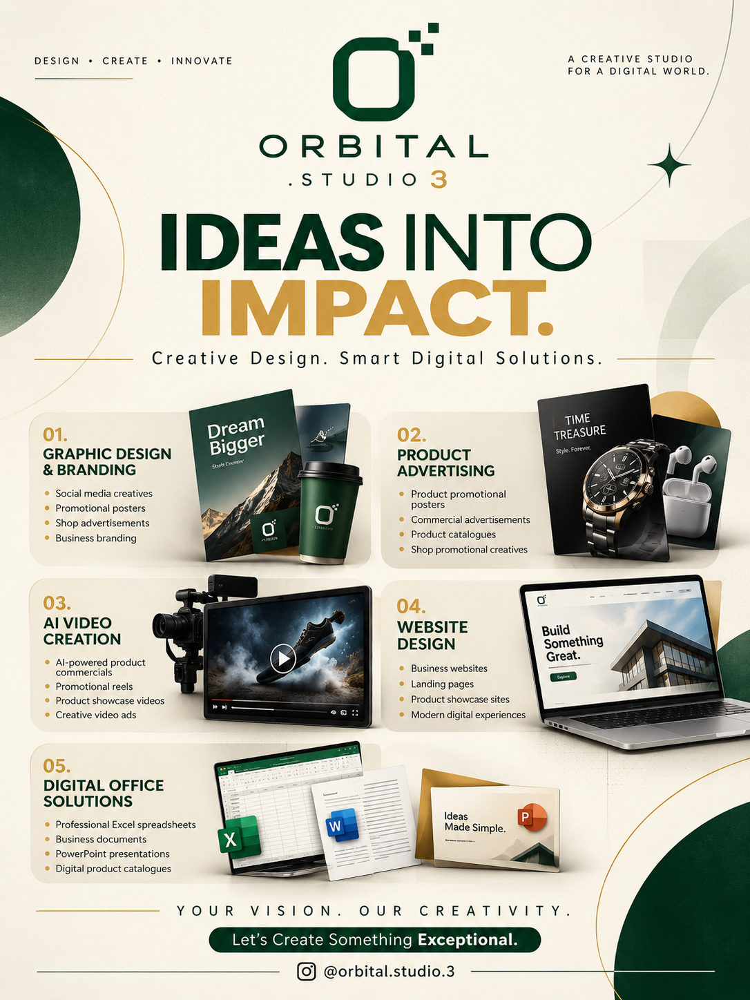

# ORBITAL OFFICE

**Work Smarter. Create Better.**
By **ORBITAL.STUDIO.3** — *Ideas Into Impact. Creative Design. Smart Digital Solutions.*

A complete, production-oriented mobile office application for Android & iOS, built with **Flutter + Dart**, **Riverpod**, **GoRouter**, **Supabase** (optional backend), **SQLite offline storage**, and a real spreadsheet formula engine.



---

## What is included

| Area | Status |
|---|---|
| Design system (Forest Green `#073D2D`, Deep Green `#0B513B`, Warm Ivory `#F5F0E5`, Premium Gold `#D5A044`, Manrope + Inter, light/dark themes) | ✅ Implemented |
| 22 screens, 5-item bottom navigation (Home · Workspace · **Create** · Business · Profile) with a visual creation sheet | ✅ Implemented |
| Auth: register, login, forgot password, logout, edit profile, delete account, guest/demo mode | ✅ Implemented (Supabase Auth when configured; clearly-labelled local-only accounts + demo mode otherwise) |
| Home dashboard: greeting, live stats, quick create, invoice analytics chart (FL Chart), recent files/activity, customisable card order | ✅ Implemented |
| Document editor: blocks (headings, paragraphs, bullets, numbered lists, tables, images, dividers), undo/redo, reorder, search-in-document, PDF export, share | ✅ Implemented |
| Spreadsheet editor: real grid, formula bar, `SUM AVERAGE COUNT MIN MAX IF`, ranges, circular-reference detection (`#CYCLE!`), dependent recalculation, sorting, filtering, currency formatting, conditional highlighting, column charts, CSV import/export, XLSX export | ✅ Implemented (pure-Dart engine, unit-tested) |
| Presentation editor: add/duplicate/reorder/delete slides, text, bullets, image refs, backgrounds, templates, present mode, PDF export | ✅ Implemented |
| Invoices & quotations: auto calculations (line + invoice discount, configurable tax label/rate — never assumed), payment recording, overdue status, quotation→invoice conversion, print-ready PDF | ✅ Implemented (INR default) |
| Customer CRM: full profile, lead stages `NEW → CONTACTED → INTERESTED → QUOTATION_SENT → CONVERTED → CLOSED`, follow-ups, billing history, search + stage filters | ✅ Implemented |
| Inventory: products, SKU, categories, purchase/selling price, stock in/out with movement history, low-stock alerts + notifications, CSV import/export | ✅ Implemented |
| Projects & tasks: projects with progress, priorities `LOW/MEDIUM/HIGH`, statuses `TO_DO/IN_PROGRESS/COMPLETED`, Kanban board, calendar view | ✅ Implemented |
| AI Office Assistant: chat, suggested prompts, copy, insert-into-document, loading/error states | ✅ Demo/offline mode implemented (template-based, labelled unverified); ✅ Supabase Edge Function included for a real provider — key stays server-side |
| Template gallery: 16 original ORBITAL templates, categories, search, favourites, recently used, one-tap use | ✅ Implemented |
| File manager: my/recent/favourite files, type filters, search, rename, delete, open-in-editor | ✅ Implemented |
| Notifications: in-app centre (low-stock, sync, billing), mark read | ✅ Implemented (FCM activates with backend — see docs) |
| Offline-first: SQLite (sqflite) persistence, pending-sync queue, conflict rule *"never overwrite newer server data"*, retry | ✅ Implemented |
| Supabase: full SQL migration (25 tables, indexes, triggers, RLS, storage policies), seed, AI Edge Function | ✅ Included in `supabase/` |
| Tests: formula engine, invoice maths, validators, sync conflicts, AI, CSV, model round-trips, widget tests, integration test | ✅ Included in `test/` |

### Honest limitations

See **[docs/FEATURE_STATUS.md](docs/FEATURE_STATUS.md)** for the detailed, unsugar-coated matrix — including what is a preview vs. fully working (e.g. DOCX/PPTX export, Rive animations, FCM push, iOS validation) and how each is completed.

> ⚠️ **Build validation note:** this source was developed in an environment without a Flutter SDK (Google's SDK download host was unreachable), so `flutter analyze`, `flutter test` and APK builds have **not** been executed by the author. No test results are claimed. The code avoids code-generation packages precisely so a first `flutter pub get` is deterministic. Run the commands in [docs/BUILD.md](docs/BUILD.md) on your machine first.

---

## Quick start

```bash
cd orbital_office

# 1. Generate platform folders (keeps lib/, pubspec.yaml, test/ intact)
flutter create --platforms=android,ios --org com.orbitalstudio3 .

# 2. Get packages
flutter pub get

# 3a. Run fully offline (demo workspace, no backend needed)
flutter run

# 3b. Run with your Supabase project
flutter run \
  --dart-define=SUPABASE_URL=https://YOUR_PROJECT.supabase.co \
  --dart-define=SUPABASE_ANON_KEY=YOUR_PUBLIC_ANON_KEY
```

Tap **Explore Demo Workspace** on the login screen to try everything instantly with clearly-labelled sample data.

## Project structure

```
lib/
  core/        theme, constants, routing, services (formula engine,
               invoice calculator, PDF, AI, sync, local DB), utilities, widgets
  features/    authentication, dashboard, workspace, documents, spreadsheets,
               presentations, invoices, crm, inventory, projects,
               ai_assistant, templates, file_manager, notifications,
               profile, settings
  data/        models, repositories (AppController + template catalogue)
  main.dart, app.dart
supabase/
  migrations/  full schema + RLS + storage policies
  functions/   ai_assistant Edge Function (server-side AI key)
  seed.sql     public template catalogue
test/          unit/, widget/, integration/
docs/          ARCHITECTURE.md, BUILD.md, FEATURE_STATUS.md
```

## Documentation

- [Architecture & data flow](docs/ARCHITECTURE.md)
- [Build & deployment (APK, AAB, iOS)](docs/BUILD.md)
- [Feature status — working vs preview](docs/FEATURE_STATUS.md)

## Brand

- Parent brand: **ORBITAL.STUDIO.3** — *Design • Create • Innovate*
- Tagline: **Your Vision. Our Creativity. Let's Create Something Exceptional.**
- Instagram: [@orbital.studio.3](https://instagram.com/orbital.studio.3)
